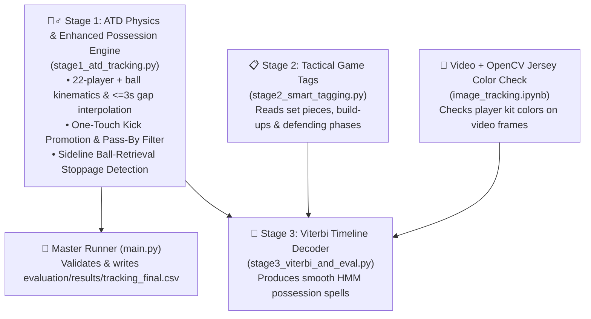

# ⚽ Football Possession Detection Pipeline (`Tracking/`)

Welcome! This folder contains our end-to-end system for automatically determining **which team has control of the ball** (or whether the ball is **out of play**) for every single frame of the match between **FC Barcelona** and **Athletic Club**.

This guide is written so that **anyone—whether you are a football coach, analyst, judge, or software engineer—can understand how our system works, how to run `main.py` in one command, and where the submission CSV goes.**

---

## 🚀 Quick Start: Run Everything with `main.py`

From the `Football-Possession/` root directory, run:

```bash
python Tracking/main.py
```

### What `main.py` Does Automatically:
1. **Loads all tracking & tactical data** (`199,319` frames at `25 fps` + `638` Smart Tagging tactical events).
2. **Runs our #1 Enhanced Hybrid ATD Possession Engine** ([`stage1_atd_tracking.py`](stage1_atd_tracking.py)).
3. **Writes the final CSV to [`evaluation/results/tracking_final.csv`](../evaluation/results/tracking_final.csv)**.
4. **Validates the CSV format** using [`evaluation/validate_submission.py`](../evaluation/validate_submission.py) (`199,319` rows, valid `H/A/D/X` labels).
5. **Scores and ranks the CSV** on the official leaderboard using [`evaluation/run_evaluation.py`](../evaluation/run_evaluation.py) and updates [`evaluation/scoreboard.csv`](../evaluation/scoreboard.csv).

---

## 📍 Where Does the CSV Need to Be Written?

There are **two places** depending on whether you are **evaluating locally** or **submitting officially to the competition**:

1. **For Local Evaluation (`evaluation/run_evaluation.py`):**
   - The official evaluation script automatically scans **every `.csv` file inside [`evaluation/results/`](../evaluation/results/)**.
   - Running `python Tracking/main.py` automatically writes [`evaluation/results/tracking_final.csv`](../evaluation/results/tracking_final.csv), so it is immediately picked up and ranked #1 on the scoreboard.
2. **For Official Competition Submission ([`SUBMISSION.md`](../SUBMISSION.md)):**
   - For the final hackathon upload form, your CSV file must be named after your registered team (`<team_name>.csv`, e.g., `BarcaAnalytics.csv`).
   - You can generate both the local evaluation CSV and your team-named CSV in a single command:
     ```bash
     python Tracking/main.py --out MyTeamName.csv
     ```

---

## 🎯 1. What Problem Are We Solving? (The Plain-English Version)

Imagine watching a full 90-minute football match recorded at **25 pictures (frames) per second**. That adds up to **199,319 frames** of video. For every single frame during the 1st and 2nd halves, we have to write down one of three letters:
- **`H` (Home — FC Barcelona):** Barcelona is in controlled possession of the ball.
- **`A` (Away — Athletic Club):** Athletic Club is in controlled possession of the ball.
- **`D` (Dead Ball):** The game is paused (for example: the ball went out of bounds for a throw-in, corner kick, goal kick, or the referee blew the whistle for a foul).
- *(Outside of the two halves—such as pre-match warmups and halftime—we write **`X`**, which means the game isn't being played).*

### Why is a Simple Computer Program Easily Fooled?
A basic computer program (like the starter baseline provided in the competition) uses a naive rule:
> *"Look at where the ball is on the pitch right now. Whichever player is standing closest to the ball, give possession to their team. If the camera loses sight of the ball, call it a Dead Ball (`D`)."*

In real football, **this naive rule fails constantly** for three everyday reasons:
1. **Passes in Mid-Air:** When a Barcelona player kicks a long pass across the pitch, the ball travels past two Athletic Club defenders who happen to be standing near its path. A naive program thinks possession switched from *Barcelona $\to$ Athletic $\to$ Barcelona* in the span of one second! In reality, Barcelona kept possession the entire time.
2. **Deflections, Blocks, and Rebounds:** If Barcelona shoots, and the ball bounces off an Athletic defender's shin right back to Barcelona, Athletic never gained *control* of the ball. Football rules say possession stays with Barcelona unless Athletic actually controls the ball.
3. **The Disappearing Ball Problem (41% of the Match!):** Automatic cameras lose sight of the ball **41% of the time**—whenever the ball is kicked high into the air, hidden behind a crowd of players in the penalty box, or blurred by fast movement. A naive program panics whenever the ball disappears and says *"Dead Ball (`D`)!"*—cutting a single 20-second Barcelona attack into five tiny, broken pieces.

---

## 🏆 2. How Our System Is Judged (`spellF1` vs. `macroF1`)

The competition uses two main scores to grade our predictions:

1. **`spellF1` (The Main Ranking Score — "Did we get the whole possession right?"):**
   - A football coach doesn't care about individual 0.04-second video frames; a coach counts **possessions** (e.g., *"Barcelona held the ball for 15 seconds, then Athletic won it for 12 seconds"*).
   - If Barcelona holds the ball for 20 seconds, and our program flickers for just half a second in the middle, `spellF1` penalizes us heavily because we turned **1 real possession** into **2 fake possessions**.
2. **`macroF1` (The Tie-Breaker — "Did we get each individual frame right?"):**
   - Checks frame-by-frame accuracy across `H`, `A`, and `D` equally.

**Our Goal:** Keep possessions whole and smooth (to win on `spellF1`) while pinpointing the exact moment possession changes hands or goes dead (to win on `macroF1`).

---

## 🧩 3. How Our Pipeline Works Across Stages 1–3



### 🏃‍♂️ Stage 1: The Physics, Geometry & Enhanced Possession Engine ([`stage1_atd_tracking.py`](stage1_atd_tracking.py))
Stage 1 is our unified ATD physics and possession engine:
- **Part 1A — Raw ATD Geometry & Probabilities (`compute_stage1_features`):**
  - Reads `BAR-ATH_tactical_atd.txt` (`199,319` frames of `(x, y)` coordinates in meters on the `105.3m × 68.0m` pitch).
  - **Connects the dots when the ball briefly vanishes** (`<= 3.0 seconds` inside the pitch) so aerial passes don't trigger fake stoppages.
  - **Measures player proximity (`2.0m` control radius)** and suppresses `< 0.48s` single-frame deflections.
- **Part 1B — Enhanced Hybrid Possession Engine (`detect_enhanced_stoppages` + `label_enhanced`):**
  - Combines the physical stoppage and relative-velocity framework from `possession/` with three crucial football physics upgrades:
    1. **One-Touch Kick & Clearance Promotion (`enhanced_control_events`):** A one-touch pass or clearance only stays near a player's foot for `5–9 frames` (`0.20–0.36s`) before flying away at `> 8.5 m/s`. We promote these impulse kicks to full control whenever that player's team stays closest along the ball's subsequent trajectory.
    2. **Sandwiched Pass-By & Deflection Suppression (`clean_segment_changes`):** Filters out isolated single-event opponent brushes (`<= 15 frames` / `0.60s`) when a pass rolls past an opponent without them ever making a second touch, preventing a 40-second buildup from fracturing into 3 pieces.
    3. **Sideline Walking Ball-Retrieval Stoppage Extension (`detect_enhanced_stoppages`):** Recognizes that when all 22 players are walking (`all_mean_speed < 1.12 m/s`) and the ball is near the sideline (`< 8.5m`), a gentle ball toss (`< 11 m/s`) to retrieve the ball for a throw-in is still part of the **Dead Ball (`D`)** stoppage—not live play.

### 📋 Stage 2: The Tactical Coach's Notebook ([`stage2_smart_tagging.py`](stage2_smart_tagging.py))
- Reads `BAR-ATH_tactical_smart_tagging.xml` (`638` match events).
- **Inverts defensive tags:** Knows that `"DEFENDING IN DEFENSIVE THIRD — Team: Barcelona"` means **Athletic Club (`A`)** has the ball.
- **Splits Set Pieces into Setup (`D`) vs. Kick (`H`/`A`)** using Stage 1 ball speed (`>= 3.5 m/s`), and **automatically resolves all 26 mystery Throw-ins (`Team = N/A`)**.

### 🧠 Stage 3: Viterbi Timeline Decoder ([`stage3_viterbi_and_eval.py`](stage3_viterbi_and_eval.py))
- Runs a **3-State Viterbi Decoder** that fuses Stage 1A and Stage 2 into smooth possession spells (`spellF1 = 0.4556`).

### 🎥 Optional Visual Inspection Tools ([`visual_kit_check.py`](visual_kit_check.py) & [`image_tracking.ipynb`](image_tracking.ipynb))
- Uses **Homography** (`BAR-ATH_tactical_homography.csv`) and **RF-DETR** ([`image_tracking.ipynb`](image_tracking.ipynb)) to project 2D pitch coordinates onto the `1920×1080` video (`BAR-ATH_tactical.mp4`).
- Uses **OpenCV HSV grass-masking** to strip green pitch pixels and inspect Barcelona vs. Athletic Club jersey colors for debugging/auditing (not required to generate `tracking_final.csv`).

---

## 📊 4. Official Scoreboard Results

Tested via `python evaluation/run_evaluation.py` against the public 5-minute ground-truth benchmark (`17` real possessions, mean duration `14.2s`):

| Rank | Submission Name | **`spellF1` (Primary Rank)** | **`macroF1` (Tie-Breaker)** | Predicted Possessions (`GT = 17`) | Mean Length (`GT = 14.2s`) | Transition F1 (`transF1`) |
|---:|---|---:|---:|---:|---:|---:|
| 🥇 **1** | **`tracking_final` (`main.py` / Stage 1 Enhanced)** | **0.5419** | **0.8636** | **14** | **18.1 sec** | **0.3784** |
| 🥈 **2** | **`pipeline_stage3` (Stage 1A+2+3 Viterbi)** | **0.4556** | **0.6803** | **19** | **13.7 sec** | **0.3256** |
| 🥉 3 | `baseline_smooth125` | 0.4242 | 0.5812 | 16 | 18.5 sec | 0.1667 |
| 4 | `ours` (`possession/` baseline) | 0.4000 | 0.8155 | 15 | 17.4 sec | 0.2632 |
| 5 | `baseline_smooth50` | 0.3256 | 0.6207 | 26 | 10.8 sec | 0.0816 |
| 6 | `baseline_smooth25` | 0.2868 | 0.6200 | 36 | 7.6 sec | 0.2034 |
| 7 | `baseline_raw` | 0.0378 | 0.5972 | 131 | 2.0 sec | 0.1410 |

---

## 🗂️ 5. Clean File Structure in `Tracking/`

| File | Role |
|---|---|
| **[`main.py`](main.py)** | **Master entry-point script.** Runs the full pipeline, generates `evaluation/results/tracking_final.csv` (plus optional `--out <team_name>.csv`), validates format, and prints the official scoreboard. |
| **[`stage1_atd_tracking.py`](stage1_atd_tracking.py)** | **Stage 1 (#1 Engine):** Unified ATD geometry & physics engine + Enhanced Hybrid Possession Engine (one-touch kick promotion, sandwiched pass-by suppression, and sideline ball-retrieval stoppage detection). |
| **[`stage2_smart_tagging.py`](stage2_smart_tagging.py)** | **Stage 2:** Smart Tagging XML parser, defensive phase inversion, set-piece Dead/Live splitter, and 26 `N/A` throw-in resolver. |
| **[`stage3_viterbi_and_eval.py`](stage3_viterbi_and_eval.py)** | **Stage 3:** Pure 3-state Viterbi HMM timeline decoder fusing Stage 1A + Stage 2. |
| **[`visual_kit_check.py`](visual_kit_check.py)** | **Optional Visual Audit:** Standalone OpenCV + Homography jersey color checker on video frames (not used in `tracking_final.csv`). |
| **[`image_tracking.ipynb`](image_tracking.ipynb)** | **Visual Notebook:** Inspect any video frame with **RF-DETR** or **Homography** bounding boxes and **OpenCV** jersey color extraction. |
| **[`README.md`](README.md)** | This complete guide to the `Tracking/` folder. |
